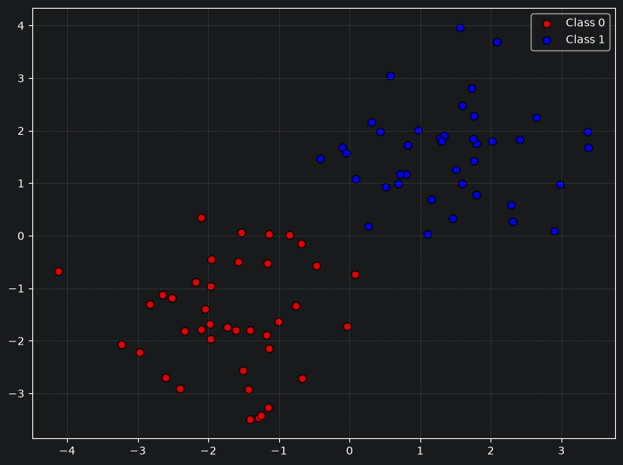
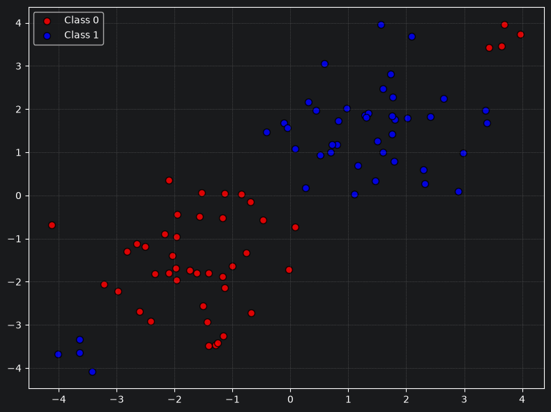
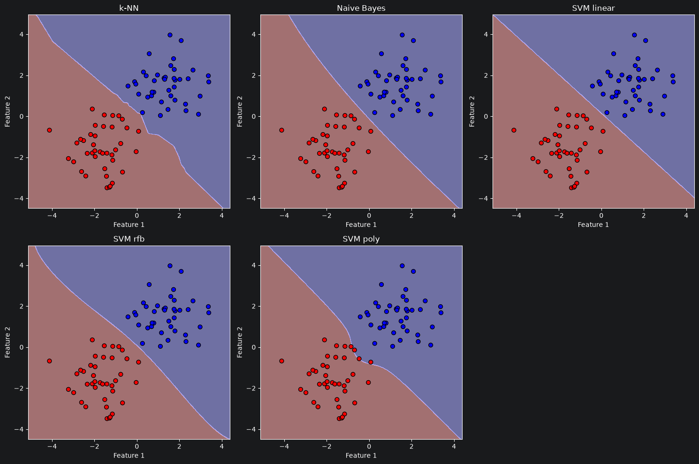
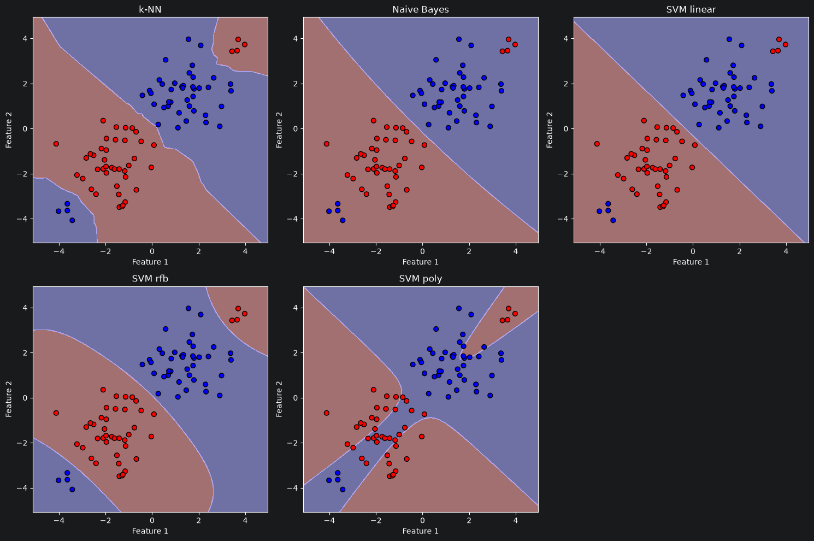
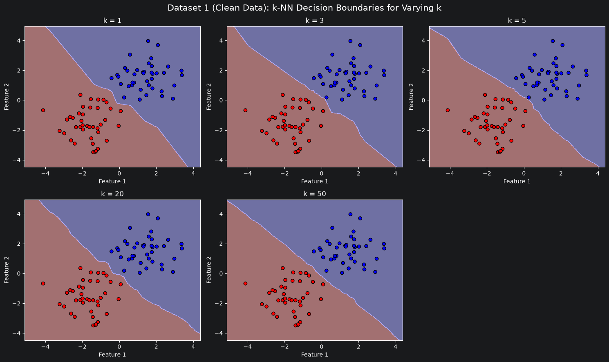
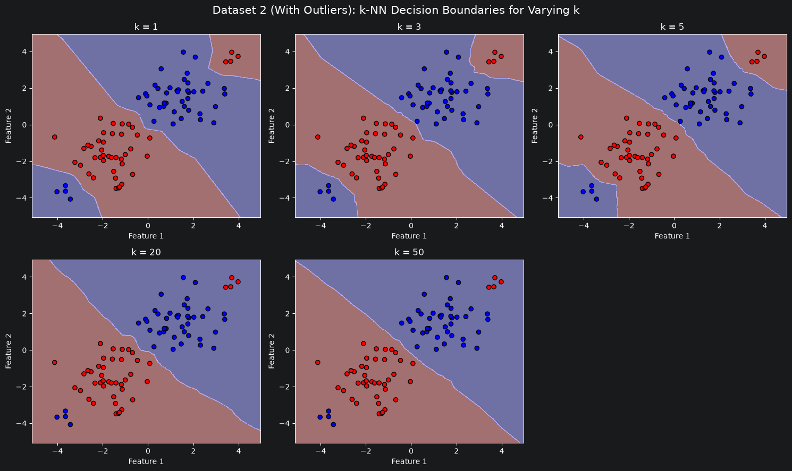

# Supervised Learning (Classification) & Bias-Variance Tradeoff Report

## 2. Task Report (Solutions, Visualizations & Analysis)

### B.I. Classification Models Comparison

#### B.I.1 Dataset 1 Creation

Generated using `sklearn.datasets.make_blobs` with `random_state=42`. Two isotropic 2D Gaussian clusters:

- Class 0 (40 points): Centered at $(-1.5, -1.5)$, standard deviation $\sigma = 1.0$.
- Class 1 (40 points): Centered at $(1.5, 1.5)$, standard deviation $\sigma = 1.0$.
- Attributes: Two continuous real-valued coordinates (`Feature_1`, `Feature_2`).

#### B.I.2 Dataset 2 Creation

We added 4 outliers per class randomly using `np.random.normal(scale=0.3)` deep into the opposing class cluster:

- Class 0 Outliers (4 points): Centered at $(3.5, 3.5)$ inside Class 1's territory.
- Class 1 Outliers (4 points): Centered at $(-3.5, -3.5)$ inside Class 0's territory.

#### B.I.3 Train / Test Split

We decided to split dataset into 75% training and 25% testing.
Normally you would do 80% and 20% respectively,
but we have very small datasets 80 and 88 elements and they both are divisible by 4, but not by 5.

#### B.I.4 Model Training & Implementation Justifications

We used `sklearn.neighbors.KNeighborsClassifier` with k=3, `sklearn.naive_bayes.GaussianNB` and  `sklearn.svm.SVC` with
default `rbf` kernel, C=1.0 and random_state=42.

##### Empirical Performance

| Dataset | Model       | Train Accuracy | Test Accuracy | Confusion Matrix (Test) |
|---------|-------------|----------------|---------------|-------------------------|
| 1       | k-NN        | 100.0%         | 100.0%        | `[[10, 0], [0, 10]]`    |
| 1       | Naive Bayes | 100.0%         | 100.0%        | `[[10, 0], [0, 10]]`    |
| 1       | SVM         | 100.0%         | 100.0%        | `[[10, 0], [0, 10]]`    |
| 2       | k-NN        | 100.0%         | 100.0%        | `[[11, 0], [0, 11]]`    |
| 2       | Naive Bayes | 90.91%         | 90.91%        | `[[10, 1], [1, 10]]`    |
| 2       | SVM         | 100.0%         | 100.0%        | `[[11, 0], [0, 11]]`    |

##### Discussion of Results

All three models achieve 100% accuracy on dataset 1 because the two Gaussian blobs have a wide, empty gap between them.

For k-NN it stays at 100%, because decisions depend purely on the 3 nearest neighbors.
Because test points stay close to their dense clusters, the outliers or main blobs are never close enough
to be picked as neighbors.

For the dataset 2 GaussianNB drops to 90.91%. Confusion matrix shows 2 errors, 1 per each class.
Naive Bayes computes global mean and variance per class.
The outliers pull the estimated means outward. This tilts the decision line,
causing points at the edges of the clusters to be misclassified.

SVC also stays at 100% because rbf kernel creates tight, localized non-linear contours around the outliers
while leaving the main boundary between the primary blobs clean.

#### B.I.5 SVM Regularization ($C$) and Kernel Exploration (on Dataset 2)

| Kernel     | $C = 0.01$ | $C = 1.0$ | $C = 100.0$ |
|------------|------------|-----------|-------------|
| Linear     | 90.91%     | 90.91%    | 90.91%      |
| RBF        | 90.91%     | 100.0%    | 100.0%      |
| Polynomial | 59.09%     | 81.82%    | 90.91%      |

For linear kernel accuracy remains fixed at 90.91% across all $C$.
A straight line cannot separate outliers placed on the opposite side of space.
In the 22 test samples, exactly 2 are outliers. It correctly
classifies the 20 cluster points and misses the 2 outliers.

For the RBF kernel at low $C=0.01$, it behaves like a linear separator. At $C \ge 1.0$ and higher,
the penalty for misclassification is strong enough that the RBF kernel bends local contours around the outliers,
achieving 100%.

For the polynomial kernel performance improves steadily ($59.09\% \to 81.82\% \to 90.91\%$) as $C$
increases. High $C$ forces the polynomial curve to bend closer to the data,
but it cannot isolate local points as cleanly as rbf.

#### B.I.6 Decision Boundary Visualizations

##### Dataset 1

##### Dataset 2

##### Visual Observations & Model Behavior

1. k-NN: on clean data, the boundary cuts between the blobs. On dataset 2, it forms
   small, "islands" around the isolated outliers.
2. Naive Bayes: produces a smooth boundary. On dataset 2 it slightly moves.
3. SVM linear: a straight line cutting between the two main clusters. It completely ignores the outliers because
   separating them with a single line is impossible.
4. SVM RBF forms bubbles around one of the clusters and outliers.
5. SVM poly curves to reach toward the outliers, but distorts the global boundary in the process.

#### B.I.7 Similarities and Dissimilarities Between Models

| Aspect              | k-NN                                   | Naive Bayes                           | Support Vector Machine                     |
|---------------------|----------------------------------------|---------------------------------------|--------------------------------------------|
| Model Type          | Non-parametric, instance-based         | Parametric, probabilistic generative  | Parametric / non-parametric                |
| Decision Boundary   | Piecewise-linear, jagged, highly local | Smooth quadratic (elliptic/parabolic) | Linear or smooth non-linear (RBF/poly)     |
| Outlier Sensitivity | Forms small islands for low $k$        | Severely distorts mean                | RBF isolates outliers; linear ignores them |
| Core Assumption     | Closer points share the same class     | Features are independent gaussians    | Maximum margin hyperplane separation       |

### B.II. Bias-Variance Tradeoff

#### B.II.1 Impact of Increasing $k$

##### Dataset 1

##### Dataset 2 (With Outliers)

##### Discussion of Boundary Evolution

Dataset 1:
With $k=1, 3, 5, 20$ we can see clear boundary that separates the two clusters through the gap between clusters. 
The boundary follows every training point on the border with a slight difference for $k=5$ where point is almost on a border.

With $k=50$ the boundary becomes almost flat, more than half the points vote, resulting in an almost straight line.

Dataset 2:
With $k=1, 3, 5$ we can see boundary that separates the two clusters through the gap between them 
and for the outliers it forms small, "islands" around them.

With $k=20, 50$ the boundary is overly simplified and ignores local cluster shape.

#### B.II.2 Bias-Variance Tradeoff, Overfitting & Underfitting

1. Small $k$ ($k=1, 3, 5$) result in overfitting (high variance / low bias):
The model makes no rigid assumptions about the data shape, fitting the training set almost perfectly 
The line is very sharp (with ($k=5$) it is also sharp for blue outliers, because of the interesting distribution of red cluster).
Changing a single data point can shift the boundary significantly.

Big $k$ ($k=20, 50$) result in underfitting (high bias / low variance):
The model assumes that predictions should depend on a broad, global neighborhood, ignoring local details.
Adding or moving points barely changes the boundary.
