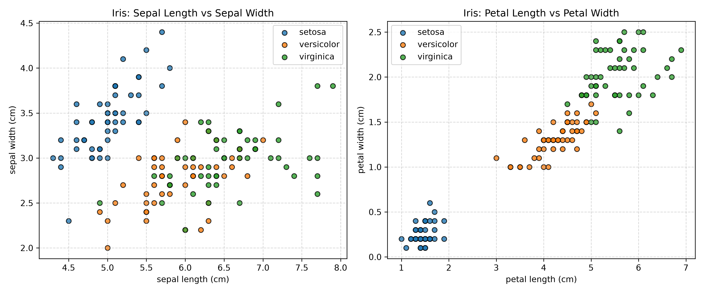
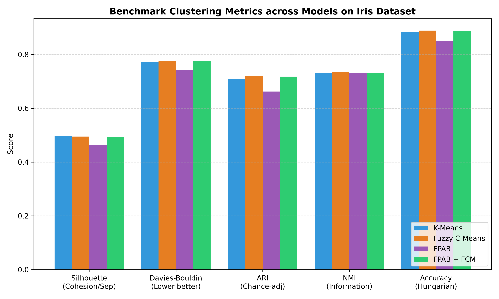
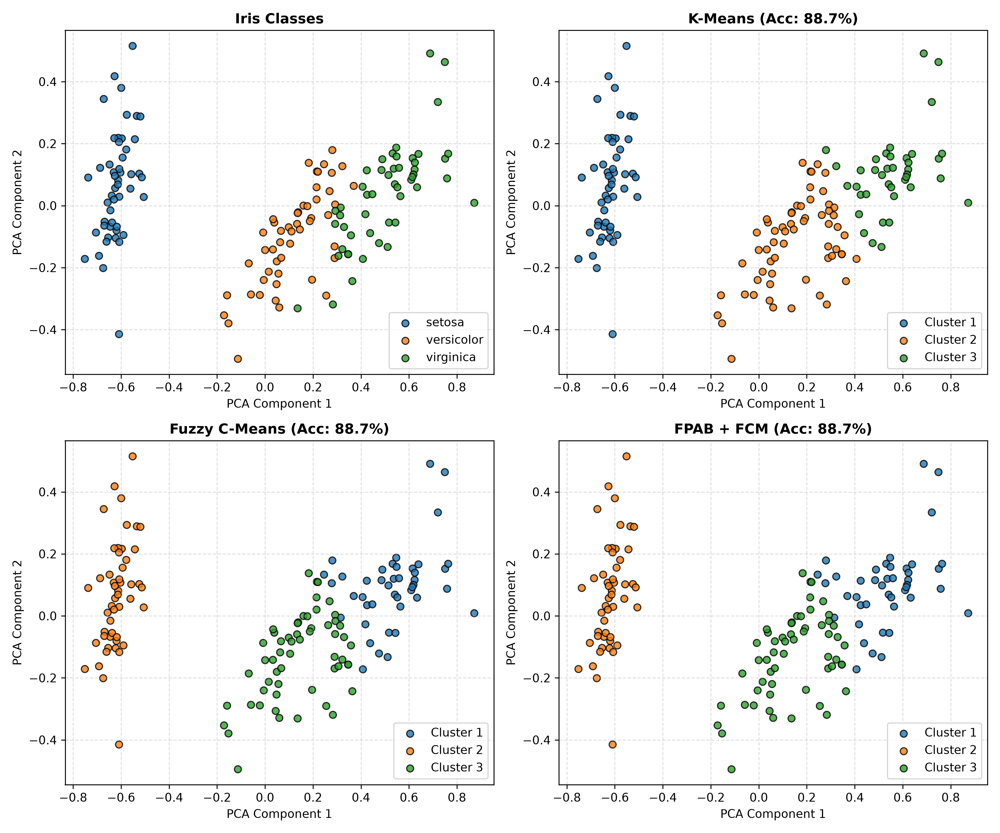
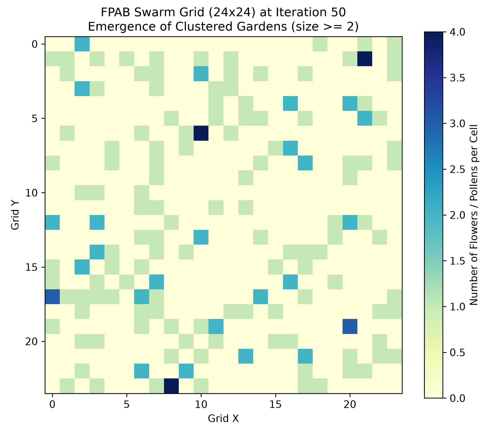

# Swarm Clustering using Artificial Bees (FPAB)
## 1. Task and Evaluation Metrics

### 1.1 Choice of the task and motivation
For this part, we chose clustering. 

Clustering is an unsupervised learning task where we group data points together based on their similarity, 
without having any target labels during training. 

Most real-world data does not come with labels. 
Finding natural groups automatically is very useful 
for discovering patterns in data. Also, some standard algorithms 
can get stuck in bad solutions if their starting points are unlucky. 
This inspired me to explore a nature-inspired swarm algorithm that uses artificial bees to find clusters.

### 1.2 Evaluation Metrics
To see how well our models group the data, we use two types of metrics:

#### Internal Metrics
1. Silhouette Score that checks if points are close to their own cluster and far from other clusters. Higher is better.
2. Davies-Bouldin Index that checks the ratio of cluster spread to cluster separation. Lower is better.
3. Calinski-Harabasz Index that measures between-cluster variance divided by within-cluster variance. Higher is better.

#### External Metrics (compared to Iris labels)

Because the Iris dataset has real species labels, we can also check how close our clusters are to the real flowers:
1. We match the cluster to the real species labels and calculate the percentage of correct predictions.
2. Use Adjusted Rand Index to measure how often pairs of points are correctly grouped together.
3. Use Normalized Mutual Information to measures how much information the predicted clusters share with the real classes.

## 2. Dataset and Preprocessing

### 2.1 Choice of dataset and motivation
We used the classic Iris dataset (150 flowers, 4 features):
sepal length(cm), sepal width(cm), petal length(cm), petal width(cm)

  

We chose this dataset because it is the exact benchmark used in the FPAB book chapter 8 (Kazemian et al., 2006).
Also it has an interesting mix of easy and hard patterns: Setosa is completely separated by sepal features 
from the other two, which overlap, making it a fair test for clustering algorithms. 
But most importantly the theme is related (artificial flowers are real flowers)

### 2.2 Data Preprocessing
To prevent features with large numbers from dominating the distance calculations, we scaled all features between 0 and 1.

## 3. Chosen Models

To compare different approaches, we chose two models:

1. Swarm Clustering based on Flowers Pollination by Artificial Bees (FPAB) is a nature-inspired swarm algorithm. 
Instead of doing standard gradient descent, it simulates bees flying around a grid moving pollen between flowers.
This helps avoid getting stuck in local minimals.
2. K-Means & Fuzzy C-Means (FCM) are the standard benchmark models for clustering. 
In fact, Kazemian et al. (2006) proposed combining FPAB with FCM: the bees find the main cluster centers, 
and FCM fine-tunes the final boundaries.

## 4. How the Models Work and How They Are Implemented

### 4.1 How FPAB Works
The algorithm imagines a jungle ecosystem:
- A toroidal 2D grid
- Each of the 150 Iris data points starts as a flower placed in a random empty cell
- 50 artificial bees fly randomly from cell to cell. Each bee can carry one piece of pollen
- When two or more flowers or pollens end up in the same cell, it becomes a Garden

The Bee's Rules:
1. Empty Bee (Looking for pollen):
   - If the bee visits a cell with 1 flower: it has a 50% chance to pick up pollen from it
   - If the cell has 2 flowers: it has a 50% chance to pick up a random flower's pollen
   - If the cell has > 2 flowers (a garden): it picks up pollen from the flower that fits the garden worst (lowest compatibility)
2. Loaded Bee (Carrying pollen):
   - The bee checks how well its pollen matches the center of the current cell
   - If the pollen fits better than the worst flower currently in the cell, it drops the pollen and picks up the worse flower's pollen
   - If the pollen fits well and is not already there, the bee plants it in the cell
3. Natural Selection:
   - At the end of each round, we check every data point: 
it only survives in the cell where it fits best (highest growth).
Suboptimal copies in other cells are removed.
4. Final Refinement (Hybrid with FCM):
   - After 50 rounds, the biggest gardens represent the discovered clusters
   - We take the centers of these gardens and pass them as initial starting points to Fuzzy C-Means (FCM), 
which does a few quick updates to settle the final cluster boundaries

### 4.2 How K-Means and FCM Work
- K-Means starts with 3 random centroids. It repeatedly assigns each point to the closest centroid, and then recalculates the centroids as the average of the assigned points, until centroids stop moving.
- FCM is similar to K-Means, but instead of assigning each point strictly to one cluster, points have a percentage membership in every cluster.

[//]: # (### 4.3 Implementation Details)

[//]: # (I implemented the algorithm cleanly in Python:)

[//]: # (- `Cell.py`: Manages the flowers in a cell, calculates cell centers, and handles pollination.)

[//]: # (- `Jungle.py`: Manages the 2D grid, bee flights, natural selection, and FCM integration.)

[//]: # (- `Entities/`: Small classes for `Bee`, `Flower`, and `Pollen`.)

[//]: # (- `main.py`: Runs data preprocessing, baseline K-Means, and the FPAB+FCM hybrid.)

## 5. Training, Results, and Discussion

### 5.1 Experimental Results
We ran all models on the scaled Iris dataset. To make sure results are fair and reliable, we tested across 5 different random seeds and averaged the numbers:

| Model | Silhouette Score $\uparrow$ | Davies-Bouldin $\downarrow$ | ARI $\uparrow$ | NMI $\uparrow$ | Accuracy $\uparrow$ | FCM Iterations |
| :--- | :---: | :---: | :---: | :---: | :---: | :---: |
| K-Means (Baseline) | 0.496 | 0.771 | 0.710 | 0.731 | 88.4% | N/A |
| FCM | 0.495 | 0.776 | 0.720 | 0.736 | 88.9% | 18.0 |
| FPAB | 0.464 | 0.742 | 0.662 | 0.730 | 85.1% | N/A |
| FPAB + FCM | 0.494 | 0.776 | 0.718 | 0.733 | 88.8% | 13.0 |

  

### 5.2 Visualizing the Clusters

  
Comparison showing Ground Truth vs. K-Means, FCM, and FPAB+FCM. All three models achieve ~88.7% accuracy.

And here is what the grid looks like after 50 iterations. Notice how the bees have gathered scattered flowers into a few dense "gardens"

  

### 5.3 Discussion of Findings
1. All models correctly identify 100% of the Setosa flowers. The errors (around 16-17 flowers) always happen between Versicolor and Virginica because their physical dimensions naturally overlap in feature space.
2. Even without any mathematical gradient descent, the swarm rules alone achieved 85.1% accuracy and a Davies-Bouldin index of 0.742 (which is actually better than K-Means and FCM). This shows that decentralized swarm rules can naturally group similar data together.
3. When we use FPAB garden centers to initialize FCM, FCM converges in 13 iterations instead of 18 iterations. The swarm places the initial centers in realistic cluster regions, avoiding bad starting spots.

## 6. Conclusion, Limitations, and Future Work (0.4 points)

### 6.1 Conclusion
In this exercise, we studied unsupervised clustering using the FPAB algorithm and compared it against K-Means and FCM. 
Pure FBAB achieved 85.1% clustering accuracy while hybrid FPAB+FCM achieved 88.8% clustering accuracy.

### 6.2 Limitations
1. Moving 50 bees across a 576-cell grid for 50 iterations requires more calculations than the fast matrix operations of K-Means.
2. If the grid is too small, flowers become crowded immediately. If it is too big, bees wander around without finding flowers often enough.

### 6.3 Future Improvements
1. We could make the bees pick up flowers easily at the start to explore, and reduce the pickup chance later so clusters settle down nicely.
2. We can allow bees to occasionally take a long jump across the grid would help them find far-away gardens faster.
3. The grid and bees could be implemented with NumPy/PyTorch tensors so they run in parallel on larger datasets.

## References
Kazemian, M., Ramezani, Y., Lucas, C., & Moshiri, B. (2006). *Swarm Clustering Based on Flowers Pollination by Artificial Bees.* In *Swarm Intelligence in Data Mining* (Studies in Computational Intelligence, Vol. 34, pp. 191–202). Springer. DOI: 10.1007/978-3-540-34155-0_8.
